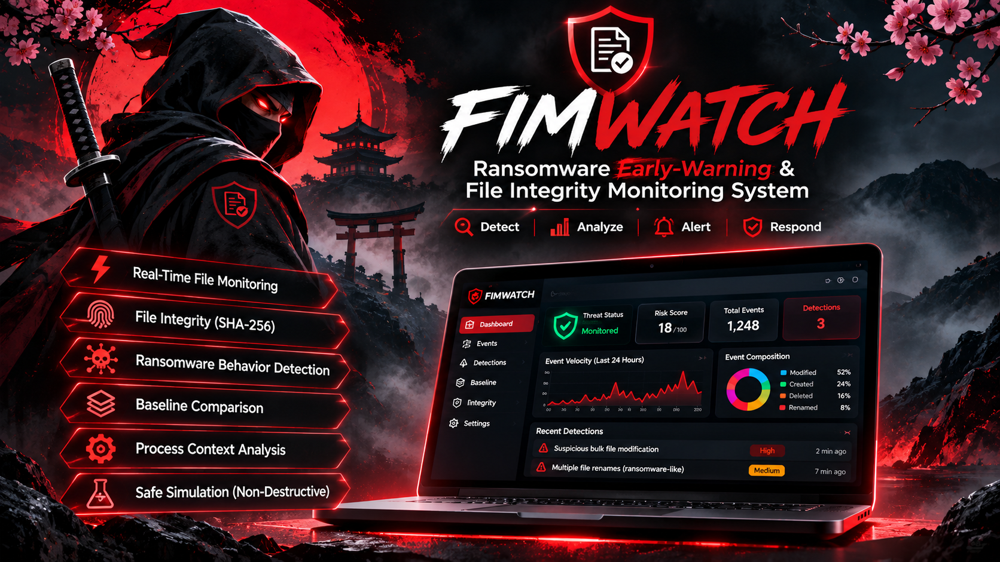

# 🛡️ FIMWATCH

### Ransomware Early-Warning & File Integrity Monitoring System

\<p align="center">
&#x20; \
\</p>

\<p align="center">
&#x20; \<strong>Detect • Analyze • Alert • Respond\</strong>
\</p>

\<p align="center">
&#x20; A safe endpoint-monitoring prototype designed to identify ransomware-like file activity and detect file-integrity violations in an isolated test environment.
\</p>

---

## 🚨 What is FIMWATCH?

**FIMWATCH** is a defensive cybersecurity prototype that monitors filesystem activity and combines multiple behavioral signals to identify potentially suspicious ransomware-like activity.

Instead of relying on a single rule, FIMWATCH correlates events such as file bursts, unusual deletion/rename activity, extension-changing renames, high event volume, and SHA-256 integrity mismatches to produce a risk-based detection.

> **Goal:** Detect suspicious file activity early, preserve evidence, and provide security teams with useful visibility before significant damage occurs.

---

## ⚡ Key Capabilities

| Capability                       | Description                                                            |
| -------------------------------- | ---------------------------------------------------------------------- |
| 🔍 **Real-Time File Monitoring** | Monitors create, modify, delete, and rename events                     |
| 🔐 **File Integrity Monitoring** | Uses SHA-256 hashes to establish and verify file integrity             |
| 🚨 **Ransomware Detection**      | Correlates multiple behavioral signals to identify suspicious activity |
| 📊 **Risk Scoring**              | Scores alerts using multiple detection signals rather than one rule    |
| 🧱 **Baseline Comparison**       | Compares current file state against a trusted baseline                 |
| 🧠 **Process Context**           | Provides best-effort process information using `psutil`                |
| 🗄️ **Evidence Store**           | Stores monitoring and detection data in SQLite                         |
| 🖥️ **SOC Dashboard**            | Provides a Streamlit-based security monitoring interface               |
| 🧪 **Safe Simulation**           | Simulates ransomware-like behavior without destructive actions         |

---

## 🖥️ Security Dashboard

The FIMWATCH dashboard provides a SOC-style view of endpoint activity, including:

- Threat posture
- Event activity
- Detection alerts
- Monitored paths
- Event velocity
- Event composition
- File-integrity status
- Recent detections
- Process context
- Baseline information

### Dashboard workflow

```text
┌──────────────────┐
│  Filesystem      │
│  Activity        │
└────────┬─────────┘
         │
         ▼
┌──────────────────┐
│ FIMWATCH Monitor │
└────────┬─────────┘
         │
         ├──────────────► SHA-256 Integrity
         │
         ├──────────────► Event Analysis
         │
         ├──────────────► Process Context
         │
         └──────────────► Behavioral Signals
                              │
                              ▼
                     ┌─────────────────┐
                     │ Risk / Detection│
                     └────────┬────────┘
                              │
                              ▼
                     ┌─────────────────┐
                     │ SOC Dashboard   │
                     └─────────────────┘
```

---

# 🚀 Quick Start

## 1. Create a virtual environment

### Linux / macOS

```bash
python -m venv .venv
source .venv/bin/activate
```

### Windows

```powershell
python -m venv .venv
.venv\Scripts\activate
```

---

## 2. Install dependencies

```bash
pip install -r requirements.txt
```

---

## 3. Create a safe test laboratory

Create an isolated directory containing test files:

```bash
python -m fimwatch.cli init-lab --path ./lab_data --files 60
```

---

## 4. Create the integrity baseline

```bash
python -m fimwatch.cli baseline --path ./lab_data
```

The baseline records the expected state of the monitored files and their SHA-256 hashes.

---

## 5. Start monitoring

```bash
python -m fimwatch.cli monitor --path ./lab_data
```

Keep this terminal running.

---

## 6. Run the safe ransomware-behavior simulator

Open another terminal and activate the same virtual environment.

```bash
python -m fimwatch.cli simulate --path ./lab_data --files 60
```

The simulator generates controlled ransomware-like filesystem activity inside the supplied laboratory directory.

---

## 7. Verify file integrity

```bash
python -m fimwatch.cli verify --path ./lab_data
```

---

# 📊 Launch the Dashboard

Start the Streamlit dashboard:

```bash
streamlit run dashboard.py
```

Then open the local Streamlit URL displayed in your terminal.

The dashboard provides a visual security-monitoring interface for the collected events and detections.

---

# 🧠 Detection Signals

FIMWATCH currently considers multiple signals:

### File-event burst

Detects unusually high filesystem activity over a short period.

### Unique file count

Tracks the number of different files affected during suspicious activity.

### Delete / rename ratio

Looks for abnormal concentrations of deletion and rename operations.

### Extension-changing renames

Identifies rename behavior where file extensions change, which can be a useful ransomware-like signal.

### High event volume

Detects unusually large numbers of filesystem events.

### SHA-256 baseline mismatch

Compares the current file state against the established integrity baseline.

---

## 🎯 Risk-Based Detection

FIMWATCH does **not** rely on a single detection rule.

Instead:

```text
File Events
     │
     ├── Event Burst
     ├── Unique Files
     ├── Delete/Rename Ratio
     ├── Extension Changes
     ├── Event Volume
     └── SHA-256 Mismatch
             │
             ▼
      Signal Correlation
             │
             ▼
        Risk Scoring
             │
             ▼
       Detection / Alert
```

This approach is intended to reduce false positives compared with triggering an alert from a single filesystem event.

---

# 🧪 Safe Demonstration

FIMWATCH includes a **non-destructive ransomware-behavior simulator** for controlled demonstrations.

The simulator operates only below the directory supplied through:

```bash
--path
```

It does **not**:

- ❌ Encrypt files
- ❌ Destroy files
- ❌ Exfiltrate data
- ❌ Establish persistence
- ❌ Disable security controls
- ❌ Modify arbitrary system files
- ❌ Operate outside the supplied laboratory directory

For demonstrations, use a disposable directory or isolated virtual machine.

---

# 🏗️ Project Structure

```text
ransomware-early-warning-fim/
│
├── dashboard.py
├── requirements.txt
├── README.md
├── PITCH.md
│
├── assets/
│   └── fimwatch-banner.png
│
└── fimwatch/
    ├── __init__.py
    ├── baseline.py
    ├── cli.py
    ├── config.py
    ├── db.py
    ├── detector.py
    ├── hashutil.py
    ├── monitor.py
    ├── process_context.py
    └── simulator.py
```

---

# 🛠️ Technology Stack

```text
Python
│
├── Filesystem Monitoring
├── SHA-256
├── psutil
├── SQLite
└── Streamlit
```

The project is intentionally lightweight so that the prototype can be demonstrated in an isolated environment without requiring a full enterprise EDR platform.

---

# 🔮 Production Upgrade Path

FIMWATCH is a prototype and should not be treated as a production EDR or forensic solution.

For production telemetry, the monitoring layer could be upgraded to OS-native or enterprise security sources such as:

### Windows

- ETW
- Sysmon
- EDR telemetry

### Linux

- fanotify
- inotify
- audit
- eBPF
- EDR telemetry

### macOS

- Endpoint Security

Process attribution in the current prototype is explicitly **best-effort** and should not be treated as forensic proof.

---

# 🛡️ Recommended Response Workflow

When suspicious ransomware-like activity is detected:

```text
1. Detect
   ↓
2. Isolate the endpoint
   ↓
3. Preserve logs and evidence
   ↓
4. Identify the responsible process/account
   ↓
5. Stop or quarantine the suspicious process
   ↓
6. Protect backups
   ↓
7. Verify backups
   ↓
8. Restore to a clean system
   ↓
9. Re-run integrity verification
   ↓
10. Document the incident timeline
```

FIMWATCH does **not** perform destructive automatic containment.

Endpoint isolation, process termination, quarantine, and other response actions should be performed through approved security controls.

---

# ⚠️ Safety & Disclaimer

FIMWATCH is intended for:

- Defensive security research
- Cybersecurity education
- Controlled laboratory testing
- Hackathon demonstrations
- File-integrity monitoring experiments

Run the project only against systems and directories you are authorized to monitor.

The ransomware simulation is specifically designed for controlled, non-destructive testing.

---

# 📌 Project Status

**Prototype / Hackathon Project**

Current focus:

- ✅ Filesystem monitoring
- ✅ SHA-256 integrity baseline
- ✅ Behavioral detection
- ✅ Risk scoring
- ✅ SQLite evidence storage
- ✅ Process context
- ✅ SOC-style dashboard
- ✅ Safe ransomware simulation

Future improvements may include richer OS-native telemetry, stronger process attribution, distributed endpoint collection, alert integrations, and production-grade response workflows.

---

## 🔐 FIMWATCH

\<p align="center">
&#x20; \<strong>Small Changes. Big Threats.\</strong>
\</p>

\<p align="center">   Detect suspicious behavior before it becomes a major incident. \</p>

\<p align="center">   \<strong>DETECT → ANALYZE → ALERT → RESPOND\</strong> \</p>
